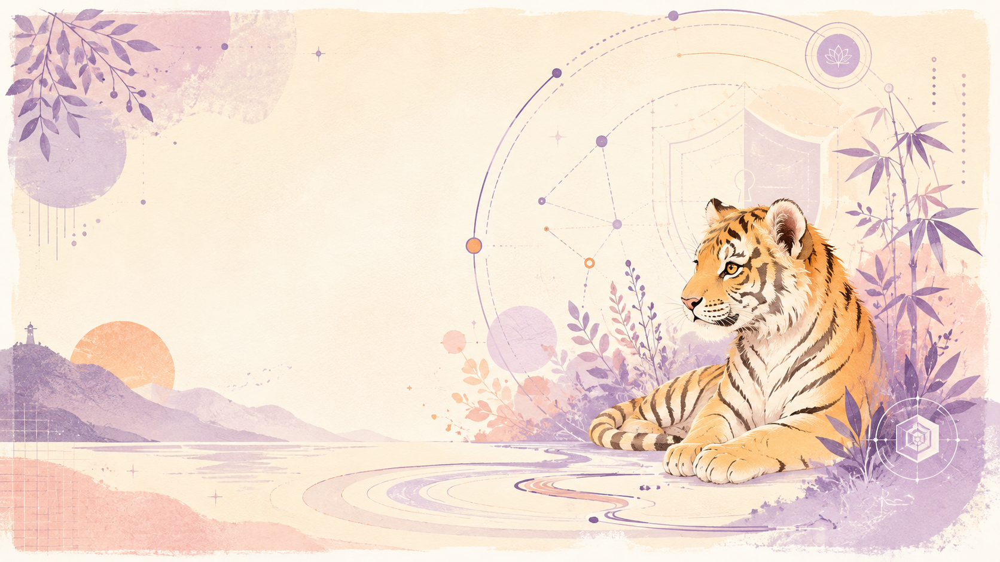

 

# Kaled SML 🐅

**Ingeniera Informática · Licenciada en Ciencias de la Ingeniería**

*Curiosidad, proyectos y un poquito de caos creativo.* 🌷

---

### ✿ Sobre mí

Me gusta convertir ideas en proyectos tangibles: investigar, diseñar, programar, probar y documentar. Exploro distintas áreas de la informática, desde la ciberseguridad hasta los experimentos creativos con Python.

### 🧸 Proyectos seleccionados

**🪷 Mishi — IA, gamificación y bienestar universitario**

Proyecto de tesis que integra un entorno 3D, interacción con IA y mecánicas de autocuidado. MVP académico; el código fuente no se publica como parte del proyecto.

**🛡️ [NIST Sentinel](https://github.com/KaledSML/nist-sentinel)**

Herramienta web de apoyo a auditorías basadas en NIST CSF 2.0.

[Demo web](https://kaledsml.github.io/nist-sentinel/) · [Video](https://www.youtube.com/watch?v=MbYpAKBpVT4)

**🐈 [Pudin: The Ghost Cat RPA](https://github.com/KaledSML/Pudin-Ghost-Cat-RPA)**

Una mascota naranja que explora Python, animaciones y automatización en Windows.

[Ver demo](https://youtu.be/UMO3PvRJNPc)

**🐙 [Seal of R'lyeh](https://github.com/KaledSML/Seal-Of-Rlyeh)**

Un experimento en desarrollo sobre cifrado de archivos. Horror cósmico bajo licencia MIT.

### 🌱 Formación y reconocimientos

- 🎓 Ingeniería Informática y Licenciatura en Ciencias de la Ingeniería; Distinción Unánime en la licenciatura.
- 🏆 Primer lugar en innovación NTT DATA–UBO.
- 🌎 Finalista internacional de AUF.
- ✨ Formación complementaria en IA, Azure, Cisco, ciberseguridad y metodologías ágiles.

### 💌 Contacto

[GitHub](https://github.com/KaledSML) · [YouTube](https://www.youtube.com/@KaledSML) · [Correo electrónico](mailto:kaledsanmartinlastra@gmail.com)

*Hecho con curiosidad y cariño.* 🌷

🐅

